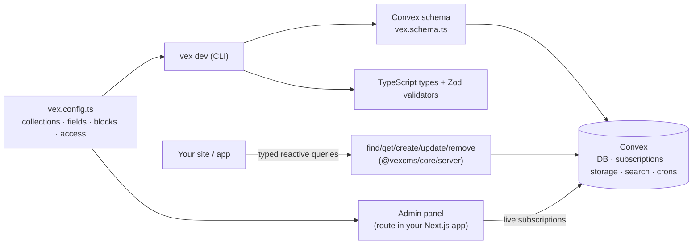

# 01 — Problem, solution, product (internal sources)

> Feeds slides: **Problem · Solution · Product/Demo · Why now (product half) · Technology/Moat**.
> Every claim here is sourced from this repo (path:line) or the live site. External market
> evidence for "why now" lives in `02-market.md`; competitor evidence in `03-competition.md`.
> As of 2026-10-12, `0.1.0-alpha.23`.

## One-liners (pick one; all are traceable to existing copy)

| Use | Line | Source |
|---|---|---|
| Hero (live site) | "The content backend for everything Convex." | `apps/www/convex/seed.ts:668` |
| Explainer | "A headless CMS that runs inside your Convex backend. You define collections in TypeScript. VexCMS generates the Convex schema and types, exports typed read and write functions, and gives your team a real-time admin panel." | `apps/www/convex/seed.ts:954` |
| Analogy (investor shorthand) | "Payload CMS, rebuilt natively for Convex's real-time backend." | `.agent/docs/research/legacy-planning/roadmap-monetization-strategy-v2.md:5` |
| Contrast | "Most of them put a REST or GraphQL API in front of a database you configure and pay for separately. VexCMS has neither." | `apps/www/convex/seed.ts:959` |

## Problem

Stated in the original product mission (Feb 2026, recovered from git history:
`git show <deleted-commit>^:agent-os/product/mission.md`) and refined by later site copy:

1. **Every existing headless CMS sits beside the app's backend, not inside it.** Teams run
   a second data store (Mongo/Postgres for Payload/Strapi/Directus, a vendor content API
   for Sanity/Contentful/BaseHub), an API layer, and cache invalidation between them.
   (`apps/www/convex/seed.ts:959`, `:903`)
2. **Not real-time.** Request/response CMSs miss reactive subscriptions; editors and
   live sites poll, rebuild, or wait on webhooks. (old mission: "Not Convex-native …
   missing real-time subscriptions and Convex's reactive data layer")
3. **Convex has no CMS.** Convex is a fast-growing reactive TypeScript backend
   (see `05-platform-convex.md`), but a Convex team that needs editors today hand-builds
   an admin panel or bolts on an external CMS — losing the type safety, transactions, and
   reactivity they chose Convex for. Verified 2026-10-12: Convex has no maintained CMS of its
   own (only a 22★ `get-convex/cms-template` starter, last pushed 2026-02), and third-party
   attempts are single-digit-star hobby projects (`03-competition.md` § Other alternatives).
4. **Payload-style DX is tied to a DB + framework.** Old mission cites "too heavy/complex",
   "admin panel bugs … UX gaps for heavy content editing", "tight Next.js coupling".
5. **On Convex, access control is hand-written and often enforced after the read.** Convex
   has no CMS-level permission layer, so teams filter documents in JS after reading them.
   VexCMS compiles row rules into the query itself (`README.md:234`,
   `apps/www/convex/seed.ts:1221`). This matters on a usage-billed backend: the versioning
   design review measured an unindexed org filter at "5,000 document reads per page view,
   which is real money on Convex's pricing"
   (`.agent/docs/specs/2026-08-23-versioning-drafts/design-review.md:396-398`). This is
   **parity with Payload** (whose collection access can return a DB `Where` constraint), delivered on Convex.

## Target users (from the original mission; still accurate)

- Developers/small teams (2–5 devs) building content-driven apps on Convex
- **Agencies building for clients** who need intuitive content editing — "an admin panel
  you can hand to a client" (`apps/www/convex/seed.ts:734`)
- Payload users who want real-time and no DB ops (`apps/www/convex/seed.ts:878`, `:967`)
- Open-source community building on Convex

Gap: no user interviews, personas, or validated ICP exist in the repo. See `07-gaps-and-asks.md`.

## Solution — how it works

One config → Convex tables, TS types, Zod validators, admin forms, typed read/write
functions, access rules (`apps/www/convex/seed.ts:711-713`, `:1034-1036`). Four-step
onboarding: `pnpm create vexcms@alpha` → define collections → build pages from blocks →
deploy (`seed.ts:913-939`, `README.md:23-57`).

**What Convex gives for free** (inherited, not built — `seed.ts:822-849`): live queries,
ACID transactions, scheduling/crons, file storage, full-text + vector search,
Convex's security/compliance posture.

## Product — shipped today (verifiable in published packages)

Source: `apps/docs/src/content/docs/roadmap.md:10-32` (public roadmap) and
`.agent/docs/product/maprios-roadmap-gaps.md:20-53` (verified against source at `bf49cd0`).

| Area | Shipped |
|---|---|
| Content model | 13 field types (text, number, checkbox, select, date, url, relationship, upload, array, group, blocks, color, richtext); collections; globals (`defineGlobal`); typed blocks page-builder; versioning & drafts with autosave, history, restore |
| Codegen | Convex schema + TS types + Zod validators from config (`vex dev` / `vex generate` / `vex deploy`) |
| Admin panel | Real-time data tables (pagination, live totals, bulk ops), media library over Convex storage, database-driven themes (OKLCH, live across tabs) |
| Access control | Document- and field-level RBAC; `{ constraints }` rules compiled to `withIndex` ranges inside Convex queries; anonymous role; per-call overrides |
| Extensibility | Lifecycle hooks (`beforeChange`/`beforeDelete` inline; `afterChange`/`afterDelete` via triggers); async server-side `validate()` with DB access |
| Editing UX | **Live preview of unsaved form state** onto the real route (postMessage + BroadcastChannel; ADR-012) |
| Public site | SEO helpers, static prerendering, revalidate-on-save, sitemap/robots |
| DX | `create-vexcms` scaffolder (marketing-site + bare + `--orgs` templates), Better Auth integration, TypeDoc API reference, `llms.txt` for AI agents (`README.md:79-81`), exported React test kit |
| Packages | 8 published npm packages, all `0.1.0-alpha.26`, Apache-2.0 (`packages/*/package.json`) |

**Not yet shipped (honest list for the deck/Q&A):** list-view search/sort, edit-view guards,
json/email/textarea fields (in v0.1.0), localization, tabs/ui fields, form builder, team
management, API keys, TanStack Start adapter, S3/R2 adapters, every paid tier
(`apps/docs/src/content/docs/roadmap.md`). Versioning & drafts shipped 2026-10-13
(`865f360`); richtext 2026-10-15 (`7d51f56`). The site itself states "Is it production
ready? Not yet." (`seed.ts:977-979`).

## Demo assets that exist

- Live marketing site built with VexCMS: https://vexcms.dev (HTTP 200, 2026-10-12)
- **Public read-only admin panel** (anonymous role) at https://vexcms.dev/admin — the
  site's own content is editable-in-view (`.agent/docs/specs/2026-09-13-discord-post-readiness/spec.md:30-33`)
- Docs: https://docs.vexcms.dev (HTTP 200, 2026-10-12)
- README hero screenshot: `.github/assets/preview.png`
- Code showcase "You write the collection. Vex writes the schema." (`seed.ts:757-759`) —
  a strong slide visual: config on the left, generated Convex table on the right.
- Original event demo flow (still the best 90-second demo once drafts + richtext land):
  "Create a post → upload a hero image → write rich text → save as draft → see it live in
  the preview pane → publish → invite a teammate → show RBAC in action"
  (`agent-os/product/event-build-plan.md`, deleted; recovered from git history).

## Technology / defensibility (what is hard to copy)

| Asset | Why it matters | Evidence |
|---|---|---|
| Row rules compiled into indexed Convex queries | Cost + correctness on a usage-billed reactive DB. Payload-level capability that did not exist on Convex | `README.md:234-266`; ADR-002/003/004; spec `2026-08-25-access-constraint-builder` |
| Live preview from unsaved form state, across tabs | Payload-level editing UX. The dual postMessage + BroadcastChannel transport also reaches tabs the admin never opened | ADR-012 (`.agent/docs/decisions/ADR-012.md`) |
| Hook split on Convex triggers | Payload-style hooks without breaking Convex transactions | ADR-010, ADR-011, ADR-014 |
| Version history designed as an append-only DAG | Enterprise content branching is additive later (no backfill) | `.agent/docs/product/backlog.md:548-627`; spec `2026-09-20-versioning-drafts` decision 11 |
| Engineering rigor | 14 ADRs; ~1,890 `test`/`it` cases across 208 test files; ~123k lines TS/TSX in `packages/*/src` + `apps/*/src` (counted 2026-10-12, excludes generated code) | `.agent/docs/decisions/`; `git ls-files` counts |
| Distribution surface | Scaffolder + templates + `llms.txt` make it agent-friendly ("vibe-coding" stacks) | `README.md:79-81` |

Caveat: the moat is mostly **ecosystem position + execution speed**, not patents. A
Convex-built first-party CMS is the main threat — see `05-platform-convex.md` § platform risk.

## Architecture decisions log (for technical due diligence)

ADR-001 … ADR-014 in `.agent/docs/decisions/` — docs contract, permission scopes, anon role,
deny posture, declaration emit, dependency catalogs, changeset cascade, app-owned Convex
deploy, React bundle graph, hook split, validation stage, live-preview transport,
client/server config split, globals write pipeline.
