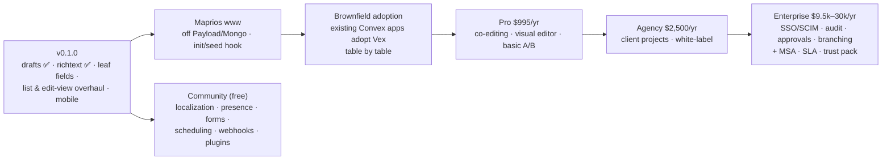

# 06 — Traction, milestones, roadmap, team

> Feeds slides: **Traction · Roadmap/Milestones · Team · (Ask/Use of funds — see 04)**.
> Numbers pulled 2026-10-12 unless stated. Internal sources are repo paths; external
> numbers link to the API that produced them.

## Timeline (verified)

| Date | Event | Source |
|---|---|---|
| 2026-02-17 | First commit | `git log --reverse` |
| 2026-02-18 | Public GitHub repo created (`ianyimi/vex`) | https://api.github.com/repos/ianyimi/vex (`created_at`) |
| Feb–Mar 2026 | v1 prototype on `master`: 16 field types, drafts, RBAC, richtext, live preview, blocks, 586+ tests — built in ~6 weeks | `.agent/docs/research/legacy-planning/roadmap-monetization-strategy-v2.md:194-236` |
| 2026-03-20 | First npm publish of `@vexcms/core` | `npm view @vexcms/core time` |
| 2026-03-27 | Targeted developer-event demo (plan existed; **attendance/outcome not recorded — ask founder**) | `roadmap-monetization-strategy-v2.md:589`; deleted `agent-os/product/event-build-plan.md` |
| Apr 2026 → | **Rebuild** branch: re-architecture (framework-agnostic core, HKT adapters, colocated types); features re-implemented rather than ported | `.agent/docs/product/mission.md:9-12`; `legacy-planning/v0.1.0-launch-roadmap.md:3-5` |
| 2026-09-02 | Presented at the **Convex meetup** (launch-readiness spec targeted this date; deployed site + public read-only admin as demo) | `.agent/docs/specs/2026-08-30-launch-readiness/spec.md:1` |
| ~2026-09-14 | Posted to the **Convex Discord show-and-tell** channel | `.agent/docs/specs/2026-09-13-discord-post-readiness/spec.md:30` |
| 2026-09-20 | Live preview shipped (`b5263dc`) | `.agent/docs/product/roadmap.md:21` |
| 2026-10-13 / 10-15 | Versioning & drafts shipped (`865f360`); richtext field shipped (`7d51f56`); `0.1.0-alpha.26` | git log |
| 2026-10-17 | Pricing decided: Community · Pro $995 · Agency $2,500 · Enterprise $9.5–30k/yr | `04-business-model.md` §4 |

**Pitch framing for the rebuild:** "Validated the full feature set in a 6-week prototype,
then rebuilt the foundation for production (framework-agnostic core, adapter architecture)
before inviting users." Have the founder confirm wording — it's an inference from the docs.

## Traction metrics available today

| Metric | Value | As of / source | Caveat |
|---|---|---|---|
| npm downloads, `@vexcms/core`, last 30 days | 1,376 | 2026-09-11→10-10, https://api.npmjs.org/downloads/point/last-month/@vexcms/core | Raw npm counts include CI, mirrors, the founder's own `verify-scaffold` runs, and 23 alpha publishes. The 7 packages all sit at 1,048–1,376 — near-identical counts across packages suggest mostly scaffold/CI installs, not distinct users. **Do not present as users.** |
| npm downloads by month, `@vexcms/core` | Mar 2,807 · Apr 454 · May 342 · Jun 338 · Jul 174 · Aug 259 · Sep 3,347 | https://api.npmjs.org/downloads/range/2026-03-01:2026-10-10/@vexcms/core | Spikes coincide with publish bursts (Mar first publish; Sep alpha series + meetup) |
| `create-vexcms` downloads, last 30 days | 1,081 | https://api.npmjs.org/downloads/point/last-month/create-vexcms | Same caveat |
| GitHub stars / forks | 8 / 1 | https://api.github.com/repos/ianyimi/vex | Small; a weak slide metric today |
| Published versions of `@vexcms/core` | 40 | `npm view @vexcms/core time` | Shipping cadence signal |
| Public demo | Live site + anonymous read-only admin | https://vexcms.dev, https://vexcms.dev/admin (200) | Strong "show, don't tell" asset |
| Engineering depth | ~1,890 test cases, 14 ADRs, ~123k LOC TS/TSX | repo counts, 2026-10-12 | Investors weigh this lightly vs. users |
| Design partner | maprios (www + app) migrating off Payload/MongoDB is the v0.1.0 acceptance target | `.agent/docs/product/mission.md:5-7`; `.agent/docs/product/maprios-roadmap-gaps.md` | Appears to be the founder's own product (sibling repo `maprios-app.git`). **Confirm relationship**; an internal dogfood customer is real but must be disclosed as such |

**Honest read:** pre-traction. The deck should lead with product velocity, ecosystem
position, and a concrete design-partner plan, and should add instrumented metrics before
pitching (see `07-gaps-and-asks.md` § metrics to start collecting now).

## Roadmap (for the Roadmap slide)

Source: `.agent/docs/product/post-v0.1.0-plan.md` (2026-10-17), `.agent/docs/product/v0.1.0-launch-plan.md`,
`apps/docs/src/content/docs/roadmap.md`, `04-business-model.md` §4.

| Phase | Contents | Status |
|---|---|---|
| v0.1.0 | Launch specs A–J: hooks/validation ✅, live preview ✅, versioning & drafts ✅, richtext ✅ (docs pending), leaf fields + localization ADR, field/edit/list-view overhauls, responsive | `v0.1.0-launch-plan.md` |
| Maprios www | ~40 block configs, 6 collections + 1 global, init/seed hook, drop Payload + MongoDB | `post-v0.1.0-plan.md` Track MW |
| Brownfield adoption | Adopt existing tables, schema introspection, auth bridge, migrations — proven on a clone of the maprios Convex app | Track AD |
| Pro → Agency → Enterprise | Paid tiers ship in price order; Enterprise gated on procurement readiness (MSA, SLA, trust pack, invoicing) | Tracks ENT-0, ENT-P |
| Community (free) | localization, presence/facepile, forms, scheduling, webhooks, API keys, team mgmt, TanStack Start, S3/R2, plugins | Track FR; `apps/docs/.../roadmap.md` |
| Exploring | multi-component workspaces, analytics adapter, MCP server, AI (bring-your-own-key) | `apps/docs/.../roadmap.md` |

Founder intent (2026-10-12): many future features will be adopted from **BaseHub** — the
BaseHub feature matrix in `03-competition.md` is the input for an expanded roadmap slide.

**Missing for the slide:** dates. No phase has a target date. Investors expect quarter-level
milestones tied to the raise (e.g. "v0.1.0 in Qx; 3 design partners in Qy; first paid
enterprise licence in Qz"). Add them in `.agent/docs/product/roadmap.md`.

## Team

| Person | Role | Evidence |
|---|---|---|
| Isaiah Anyimi | Founder, sole engineer (≈ all 286 non-bot commits) | `git shortlog -sn --all` |

Missing: bio, prior experience, why-this-founder, advisors, hiring plan. Solo-founder risk
is the first question a seed investor will ask; see `07-gaps-and-asks.md`.

## Development cadence (supporting, not headline)

Commits per month on the current branch: Feb 9 · Mar 147 · Apr 32 · May 15 · Jun 5 ·
Jul 7 · Aug 17 · Sep 59 · Oct 3 (to 10-06). Commits are squashed by the session harness,
so counts understate work; spec/ADR output (25+ specs, 14 ADRs since Aug) is a better
velocity proxy.
