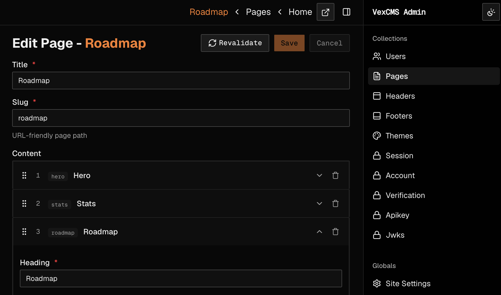

# VexCMS

> [!WARNING]
> VexCMS is pre-release software, published only under the `alpha` npm dist-tag
> (`0.1.0-alpha.x`) — the `latest` tag on npm still points at an old, unrelated
> `0.0.20` line, so installs must use an explicit tag: `pnpm create vexcms@alpha`.
> Use it for experiments and evaluation only; do not put it behind production
> traffic or real user data. Breaking changes land between alpha releases without
> deprecation cycles, and there is no migration path between alphas. See the
> [roadmap](https://docs.vexcms.dev/roadmap/) for what is and is not shipped.

[](https://www.npmjs.com/package/@vexcms/core)
[](https://github.com/ianyimi/vex/actions/workflows/ci.yml)
[](https://github.com/ianyimi/vex/blob/master/LICENSE)
[](https://github.com/sponsors/ianyimi)

<p align="center">
  
</p>

A type-safe headless CMS built natively on [Convex](https://convex.dev). VexCMS generates your
Convex schema and typed query/mutation API from a single config file, with a self-hosted
Next.js admin panel for editing content.

## Quick Start

Scaffold a complete Next.js + Convex + Vex project (answer "yes" to installing dependencies):

```bash
pnpm create vexcms@alpha my-site
cd my-site
npx convex dev --once
npx convex env set SITE_URL http://localhost:3010
npx convex env set BETTER_AUTH_SECRET <the BETTER_AUTH_SECRET value from .env.local>
```

Then run `pnpm vex:dev` and `pnpm dev` in two terminals (on the marketing-site starter, run
`pnpm seed` once while `pnpm vex:dev` is running). Open `http://localhost:3010` (or your chosen
port) and sign up — the first account is automatically promoted to admin and redirected into
`/admin`.

See the [quickstart guide](https://docs.vexcms.dev/guides/quickstart/) for each step in detail.

## Why VexCMS?

- **Convex-native**: your VexCMS config generates the Convex schema — no translation layer, no separate ORM.
- **Full type safety**: fields, relationships, access permissions, and the generated document/query types are all type-checked end to end.
- **Real-time by default**: Convex's reactive subscriptions power live updates across the admin panel and your frontend.
- **PayloadCMS-familiar DX**: if you know Payload, the collection/field/access shape will feel familiar — different runtime, similar authoring model.
- **Self-hosted**: you own your data, your Convex deployment, and your admin panel.

## Docs

The full field reference, guides (auth, access control, caching, theming, adapters, lifecycle
hooks, admin customization, list views), and the generated API reference live at
[docs.vexcms.dev](https://docs.vexcms.dev). The docs site also serves
[llms.txt](https://llmstxt.org) indexes for AI coding agents — point your agent at `/llms.txt`
(index), `/llms-full.txt` (complete docs), or `/llms-small.txt` (compact).

## Roadmap

Next comes a plugin system, then free features as demand appears — localization, scheduled
publishing, a TanStack Start adapter, a form builder, outbound webhooks, API keys and team
management — then brownfield adoption. All of it is free, in the Apache-2.0 core. See the
full [roadmap](https://docs.vexcms.dev/roadmap/).

## Compare

[VexCMS vs Payload, Sanity and Strapi](https://docs.vexcms.dev/compare/).

## Community

- **Questions and ideas**: [GitHub Discussions](https://github.com/ianyimi/vex/discussions)
- **Bugs**: [issues](https://github.com/ianyimi/vex/issues/new/choose)
- **Release emails**: [subscribe](https://buttondown.com/vexcms)
- **Contributing**: [CONTRIBUTING.md](CONTRIBUTING.md)
- **Security**: [SECURITY.md](SECURITY.md) — private vulnerability reporting, or security@vexcms.dev

## Who builds this

VexCMS is built and maintained by one developer, [@ianyimi](https://github.com/ianyimi), in
their free time. New issues are triaged within a week; how fast a fix lands depends on its
severity and on sponsorship.

## Sponsors

Sponsorship pays for time on the free core: faster bug fixes first, then the free roadmap.
Sponsor on [GitHub Sponsors](https://github.com/sponsors/ianyimi) (monthly or one-time), or
[buy me a coffee](https://buymeacoffee.com/zaye).

No sponsors yet — be the first.

## License

VexCMS is Apache-2.0 licensed. Paid add-ons may come later, as separate packages, after the
free roadmap. The core stays Apache-2.0, and nothing free becomes paid.
